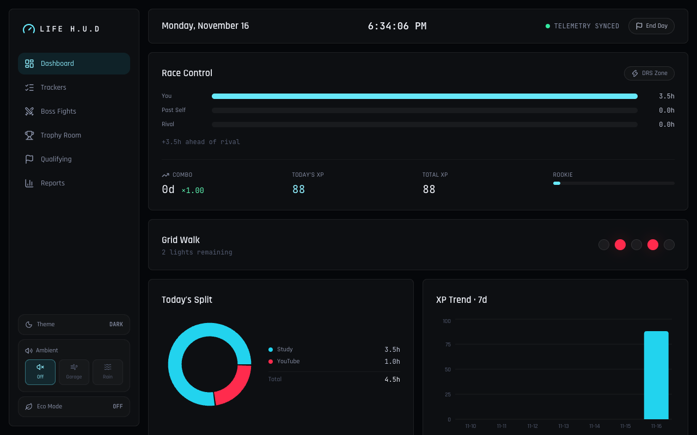

# Life H.U.D

A personal life dashboard styled like a motor-racing pit wall. You log your day (habits, study hours, weight, water,
notes) and the app turns it into XP, streaks, a 3D companion, trophies and weekly targets. It is a single-page web
app that runs entirely in your browser, with no server, no account and no network calls for your data.

Built with React, TypeScript, Vite, Tailwind CSS 4 and three.js. It's a personal project, shared as it is.

Try it live: **https://saifcs50-cs50.github.io/life-hud/** (your data stays in your own browser).



## The dashboard

Race Control compares today's productive hours with your best day and a rival over the last 7 days. The rival is
plain arithmetic: the average of your past productive days times a fixed factor (x1.075, or x1.2 after a "black
flag"). Grid Walk shows five red lights (better than yesterday, water, workout, morning routine, journal) that go
out as you tick them off.

Below that are four non-negotiables (workout, reading, journaling, eating clean), a morning and evening skincare
checklist, water glasses (8 is the goal), weight, a 1-5 skin rating, notes, and hours for study, YouTube, Instagram
and web series, plus late-night work in minutes. The Companion is a 3D shape that evolves at 1,500 and 5,000 career
XP. Tire Wear is a 3D tyre whose grip drops with study and late-night load, and each Pit Stop press restores 25%.
There are also sticky notes (Brain Dump) and two charts, Today's Split and XP Trend.

## The other pages

- Trackers: log your own activities, productive or unproductive, with hours. It also has a 30-day weight chart and a
  14-day hours chart.
- Boss Fights: exams as bosses. Give a subject, a date and the hours needed, then log hours to drain its health bar.
- Trophy Room: seven trophies unlock by themselves (first combo, 3-day streak, slipstream, 100 XP, companion stages 2
  and 3, first boss defeated).
- Qualifying: set weekly hour targets and tick them off. On Saturday and Sunday it shows next week.
- Reports: export or import everything as a JSON backup, copy a plain-text summary, or wipe all data.

There are dark and light themes, an Eco Mode that swaps the 3D cards for flat ones, and two ambient sounds (garage
hum, rain) synthesised with the Web Audio API, so the repo has no audio files.

## How XP works

Each non-negotiable is 10 XP. A complete morning or evening skincare routine is 5 each, "better than yesterday" is 5,
reaching 8 glasses is 5, and every study hour or productive tracker hour is 15 XP. Study hours count double while the
DRS Zone button is on.

A combo is all four non-negotiables in one day. Each combo day in a row adds 5% to today's XP (up to 10 days), and
three in a row switches on Slipstream (x1.5 XP). Three missed days in a row (days you logged without completing the
combo) switch on Black Flag.

## Run it

You need Node.js 20.19+ or 22.12+.

```bash
npm ci
npm run dev
```

Then open the address Vite prints (usually http://localhost:5173). Other scripts:

```bash
npm run build     # type-check and build into dist/
npm run preview   # serve the built app
npm run lint      # Oxlint
```

The live demo is the same build with GitHub Pages' sub-path: `npx vite build --base=/life-hud/` plus a copy of `index.html` as `404.html` so page links work.

## Your data

Everything is stored in your browser's IndexedDB (database `life-hud`) and `localStorage` (theme and Eco Mode only).
Clearing site data deletes it and nothing syncs between browsers or devices, so use Reports > Export Backup now and
then. Importing a backup replaces all current data.

The only outside request the page makes is for two fonts from Google Fonts (see [CREDITS.md](CREDITS.md)).

## Known gaps

- There are no automated tests.
- It's laid out for a desktop window first. On a phone the sidebar becomes a bar above the content, and the ambient
  sound control is hidden.
- The habit lists (skincare steps, non-negotiables, the tracked apps) are hard-coded in the source and can't be
  changed in the app. The Trackers page covers extra activities.
- The production bundle is one large JavaScript file (about 1.8 MB, 520 kB gzipped) because there is no code
  splitting yet.
- `npm audit` reports high-severity advisories in build-time tooling (nanoid, source-map-js, Vite's dev server).
  They aren't in code that ships to the browser, and the lockfile hasn't been updated for them.

## Credits and licence

Fonts, libraries and notes on the racing vocabulary are in [CREDITS.md](CREDITS.md). This project is not affiliated
with Formula 1 or any racing team. Released under the [MIT licence](LICENSE).
